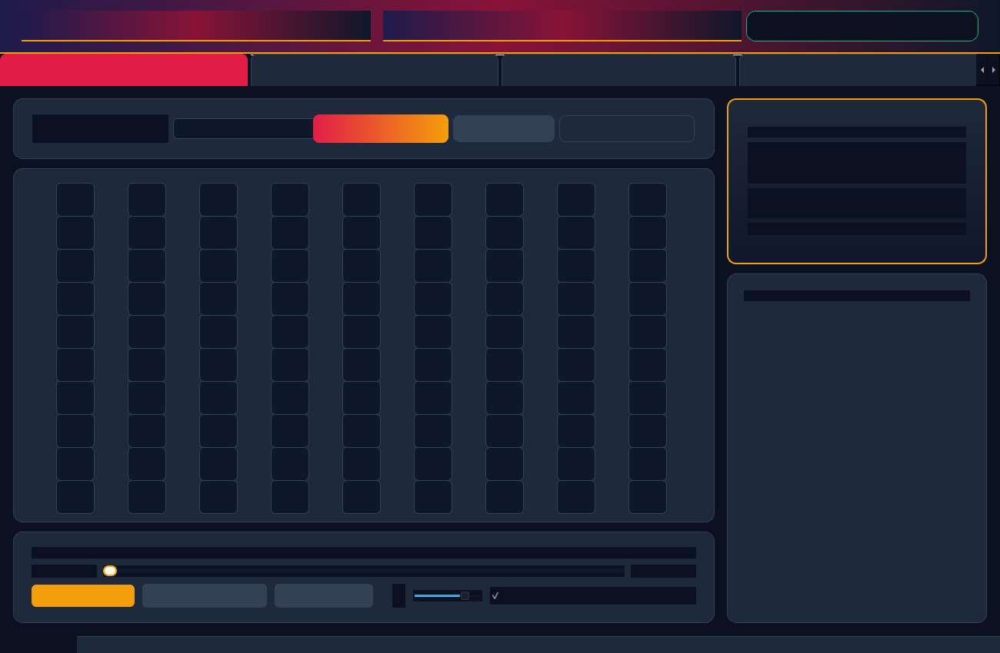

# 🎶 Musical Tambola (Housie) — Offline Master Studio & Caller

<div align="center">


**A production-grade, multi-screen offline desktop application and localhost web suite for Musical Housie (Tambola).**  
Designed for stage hosts, family galas, festivals, clubs, and corporate events with reactive sound visualizers, mathematical frequency-balanced ticket printing, instant claim verification, and animated tie-breaker raffles.

[Explore Features](#-key-features) • [Quickstart Guide](#-quickstart-guide) • [Architecture](#-project-architecture) • [Screenshots](#-screenshots--preview) • [Game Rules](#-game-rules--traditional-pillars)

</div>

---

## 🌟 Key Features

### 🎙️ 1. Live Caller & Master Stage (Screen 1)
* **Hero Calling Deck**:
  * **Animated Reactive Equalizer Graphic**: 24-bar sound equalizer that animates vertical bars with soft indigo-to-amber gradients when music plays (~28 FPS), smoothly settling to a subtle baseline when paused.
  * **Pulsing Hero Call Badge**: Prominently displays the drawn track number (`#01` to `#90`) with dynamic zoom/pulse animations.
  * **Song Information Card**: Large song title, artist, film, year, and decade pillar tag.
  * **Transport & Scrubber**: Play, Pause, Replay, Stop, volume slider (0–100%), and real-time seek scrubber slider with current/total duration readouts (`mm:ss`).
  * **Non-Repeating Random Draw**: One-click or `Spacebar` draw with live counters (`Called: 14 / 90 • Remaining: 76`).
  * **Auto-Draw Mode**: Configurable hands-free automatic timer (8s to 60s) for continuous gameplay.
* **10×9 Master Calling Board**:
  * Categorized into traditional pillars:
    * 🌸 **Satyam** (Columns 1–3 • Numbers 1–29)
    * 🌿 **Shivam** (Columns 4–6 • Numbers 30–59)
    * ✨ **Sundaram** (Columns 7–9 • Numbers 60–90)
  * Dynamic color-coded states: Pending muted neutral, called soft emerald (`#05B384`), and active track glowing amber (`#F49D37`).
  * Click any cell to inspect track details, replay music, or make manual calls.

---

### 🎰 2. Lucky Draw & Raffle Module (Screen 2)
* **Animated Rolling Lottery Slot**: Simulates a high-energy rolling slot effect cycling rapidly through numbers/names with synthetic tick sound effects before revealing the winner(s) with celebratory fanfare.
* **Simultaneous Winners**: Configurable winner count spinbox (1 to 10 simultaneous winners).
* **Prize / Claim Categories**: Presets for *Early 5 Tie-Breaker*, *Top Line Tie-Breaker*, *Middle Line Tie-Breaker*, *Bottom Line Tie-Breaker*, *Full House Tie*, *Lucky Star Raffle*, and custom entries.
* **Pool Source Filtering**:
  * 🔘 Draw exclusively from already-called numbers from Screen 1.
  * 🔘 Draw from registered ticket IDs in the active batch.
  * 🔘 Draw from all game numbers (1–90).
* **Persistent Session Audit Log**: Detailed audit table tracking timestamps, categories, pools, drawn IDs, and winner names with one-click clipboard copying.

---

### 🔍 3. Claim Verifier & Ticket Inspector (Screen 3)
* **Automated Batch Registry Loader**: Scans all historically saved `*_registry.json` files in `tickets_archive/`.
* **Instant Ticket Search**: Lookup by Ticket ID (e.g. `001`, `042`) with `◀ Prev` and `Next ▶` quick-stepper.
* **Visual 3×9 Grid Display Overlay**:
  * 🟢 **CALLED (✓)**: Cells matching drawn songs highlighted in soft emerald (`#E6F8F3`) with status badge.
  * 🔴 **PENDING (⏳)**: Uncalled cells marked in soft coral (`#FFF0F1`).
  * ⚪ **BLANK**: Grayed out Tambola slots (`#F1F5F9`).
* **Auto-Verdict Engine**: Real-time evaluation of winning combinations:
  * ✅ **Early 5 (Jaldi 5)**
  * ✅ **Top Line (Row 1)**
  * ✅ **Middle Line (Row 2)**
  * ✅ **Bottom Line (Row 3)**
  * ✅ **Four Corners**
  * 🏆 **Full House (Bingo)**
* **Master Verdict Banner**: Prominently displays valid prize claims and specifies remaining numbers needed for a Full House.

---

### 🎫 4. Ticket Generator & Template Studio (Screen 4)
* **Algorithmic Constraint Balancer**:
  * Exactly 15 songs per strip (5 per row).
  * 1 to 3 songs per column across 9 decade columns.
  * Strictly ascending column ordering.
  * **Zero song repetition** across paired strips on 2-strip landscape sheets.
  * **Global frequency balancing** across large batch runs to eliminate track oversaturation.
* **Strict Non-Destructive Storage**:
  * **Never overwrites, purges, or replaces previously archived batches.**
  * Live collision check detects existing names in `tickets_archive/` and automatically increments counters (e.g. `<Batch_Name>_02.html`) to protect previously printed tickets on game day.
* **Template Studio**:
  * Select from pre-calibrated templates (Garba Night, Festive Gold) or pick a custom PNG/JPG with a real-time thumbnail preview.
  * Pixel-perfect direct in-cell grid alignment or overlay card box mode.
* **Print & Export**:
  * Automatic export to printable HTML and JSON layout registry.
  * Direct action buttons: **🌐 Open in Browser (Print / Save as PDF)** and **📁 Open Archive Folder**.

---

### 🌐 5. Companion Web Studio Server (FastAPI)
* Optional companion web app running locally at `http://localhost:8000`.
* Provides responsive calling board, audio streaming API, claim verification, and ticket printing right in the browser.

---

## 🎨 Design System: Light Pastel / Accent Body

Built with modern UI/UX principles prioritizing visual clarity, solid body contrast, and zero eye-strain:

```
Solid Off-White Canvas    [ #F4F6FB ]
Pure White Cards          [ #FFFFFF ]   Border: #E5EAF2
Soft Indigo (Primary)     [ #5B61F4 ]   Hover:  #4D53E8
Emerald Green (Called)    [ #05B384 ]   Light:  #E6F8F3
Amber Gold (Active Glow)  [ #F49D37 ]   Light:  #FEF5EB
Coral Red (Pending/Alert) [ #FF5A5F ]   Light:  #FFF0F1
Dark Slate Typography     [ #1E293B ]   Muted:  #64748B
```

---

## 📁 Project Architecture

```
Musical_Tambola/
│
├── main_app.py                  # Primary Desktop GUI Entry Point (PyQt/PySide)
├── song_bank.py                 # Master 90-Song catalog & decade column mapping
├── web_app.py                   # Optional Localhost Web Studio Server (FastAPI)
├── config.py                    # Constants, color palette tokens & file paths
├── database.py                  # SQLite database engine & schema management
├── qt_compat.py                 # Qt compatibility abstraction (PyQt6 / PySide6 / PyQt5)
│
├── songs/                       # 90 indexed audio clips (1.wav to 90.wav)
├── assets/
│   ├── branding/                # Ticket background templates (PNG/JPG)
│   └── songs/                   # Master audio repository
│
├── generator/
│   └── generate_housie_tickets.py # Algorithmic Ticket Generator Engine
│
├── modules/
│   ├── audio_player.py          # Pygame mixer controller & synthetic sound synthesis
│   ├── game_host.py             # Calling stage widget components
│   ├── lucky_draw.py            # Raffle engine & slot animation
│   └── claim_verifier.py        # Verification cross-check logic
│
├── tickets_archive/             # Immutable archive: Permanent .html & _registry.json files
├── requirements.txt             # Python dependencies
└── README.md                    # Project documentation
```

---

## 🚀 Quickstart Guide

### 1. Prerequisites
* Python 3.10, 3.11, 3.12, or 3.13
* Windows, macOS, or Linux

### 2. Installation
Clone the repository and install dependencies:

```bash
git clone https://github.com/Hardik1036/Musical-Tambola.git
cd Musical-Tambola

# Install required packages
pip install -r requirements.txt
```

### 3. Launch Desktop Application
To launch the complete multi-screen offline desktop studio:

```bash
python main_app.py
```

### 4. (Optional) Launch Web Studio Server
To run the browser-based companion web studio on localhost:

```bash
python web_app.py
```
Open **[http://localhost:8000](http://localhost:8000)** in your browser.

### 5. Generate Tickets via Command Line
Generate batches directly from the terminal without launching the GUI:

```bash
# Generate 100 landscape sheets (200 tickets) with custom batch name
python generator/generate_housie_tickets.py --sheets 100 --format 2-strip --batch-name "Diwali_Gala_2026"
```

---

## 🏛️ Game Rules & Traditional Pillars

Musical Housie categorizes 90 evergreen tracks into 3 classical Indian aesthetic pillars:

| Pillar | Decade Columns | Track Numbers | Aesthetic / Emotion |
| :--- | :--- | :--- | :--- |
| **🌸 Satyam (The Truth)** | Columns 1 – 3 | `#01` to `#29` | Golden classics, retro melody, evergreen 60s/70s/80s |
| **🌿 Shivam (The Eternal)** | Columns 4 – 6 | `#30` to `#59` | Romantic anthems, 90s/2000s Bollywood hits |
| **✨ Sundaram (The Beauty)** | Columns 7 – 9 | `#60` to `#90` | High-energy dance, modern pop, Garba & festival celebration |

### Standard Winning Combinations
1. **Early 5 (Jaldi 5)**: First participant to strike any 5 songs on their ticket.
2. **Top Line**: All 5 songs in the first row struck.
3. **Middle Line**: All 5 songs in the second row struck.
4. **Bottom Line**: All 5 songs in the third row struck.
5. **Four Corners**: The 1st and last songs of row 1, plus the 1st and last songs of row 3.
6. **Full House (Bingo)**: All 15 songs on the strip struck!

---

## 🛡️ Non-Destructive Data Safety Guarantee

* **Permanent Batch Immutability**: Every ticket generation run creates a timestamped or uniquely counter-incremented batch.
* **Collision Guard**: If a user submits a batch name that already exists in `tickets_archive/`, the engine safely increments the name (e.g. `BatchName_02.html`) rather than replacing it.
* **Game Day Reliability**: Tickets printed days or weeks in advance remain 100% verifiable on game day because historical `_registry.json` files are never purged.

---

## 📸 Screenshots & Preview

| Live Caller Stage | Claim Verifier Overlay | Ticket Engine |
| :---: | :---: | :---: |
|  |  |  |

---

## 🤝 Contributing

Contributions, feature suggestions, and bug reports are welcome!
1. Fork the Project
2. Create your Feature Branch (`git checkout -b feature/AmazingFeature`)
3. Commit your Changes (`git commit -m 'Add AmazingFeature'`)
4. Push to the Branch (`git push origin feature/AmazingFeature`)
5. Open a Pull Request

---

## 📄 License

Distributed under the MIT License. See `LICENSE` for more information.

<div align="center">
Made with ❤️ for celebrations, music lovers, and community game hosts.
</div>
